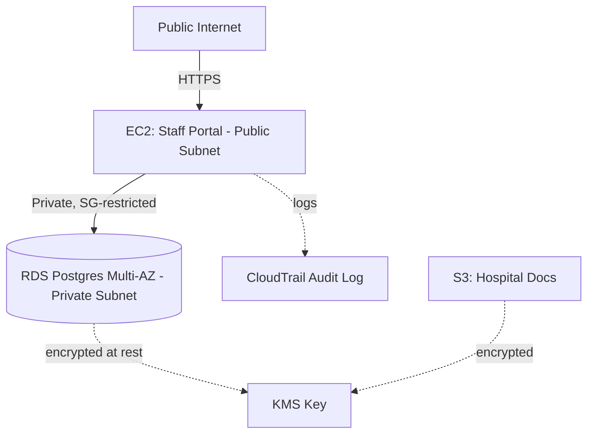

# Willow Creek Regional Hospital — Cloud Infrastructure

End-to-end cloud architecture for a rural 45-bed hospital: planning, HIPAA-conscious infrastructure design, org-structure database, and a live staff-directory portal.


## Planning summary

A hospital cloud environment has different constraints than a typical web app:

- **PHI protection** — patient data must be encrypted at rest/in transit, access-logged, never public
- **High availability** — Multi-AZ database, redundant subnets
- **Least privilege** — network segmentation so the database is unreachable except from the app tier
- **Auditability** — CloudTrail-style logging of all access

This repo intentionally does **not** include a patient-records schema — only hospital org structure (departments/staff). Real PHI systems need a dedicated, more tightly scoped design reviewed against actual HIPAA/HITECH requirements before going anywhere near production.

## Architecture



- **Public subnet** — only the staff directory portal lives here
- **Private subnets (2 AZs)** — RDS Postgres, Multi-AZ, encrypted, never publicly reachable
- **KMS** — encrypts RDS storage and S3 documents
- **CloudTrail** — audit trail for compliance
- **Security groups** — DB only accepts traffic from the portal's security group, nothing else

## Departments modeled

Executive Administration, Emergency Department, Internal Medicine, Surgery, ICU, Radiology, Laboratory, Pharmacy, IT/Health Informatics, and Housekeeping/EVS — each with a Director → Manager → Staff reporting structure.

## Repo structure

```
terraform/     — VPC, subnets, security groups, RDS, S3, KMS, CloudTrail
app/           — Flask staff-directory portal (Dockerized)
schema.sql     — Departments + employees org-structure schema
docs/          — Planning notes
```

## Deploying

```bash
cd terraform
terraform init
terraform plan -var="ami_id=ami-XXXXXXXX" -var="key_name=your-key" -var="db_password=$(openssl rand -base64 24)"
terraform apply
```

```bash
cd app
docker build -t willow-creek-portal .
docker run -d -p 80:80 \
  -e DB_HOST=<rds-endpoint> \
  -e DB_NAME=willowcreek \
  -e DB_USER=willowcreek_admin \
  -e DB_PASS=<your-db-password> \
  --name willow-creek-portal willow-creek-portal
```

## Tech stack
Terraform · AWS (VPC, EC2, RDS, S3, KMS, CloudTrail) · PostgreSQL · Flask · Docker

## Author
Built by [Derick / SIM](https://github.com/UncleD0886475978)
